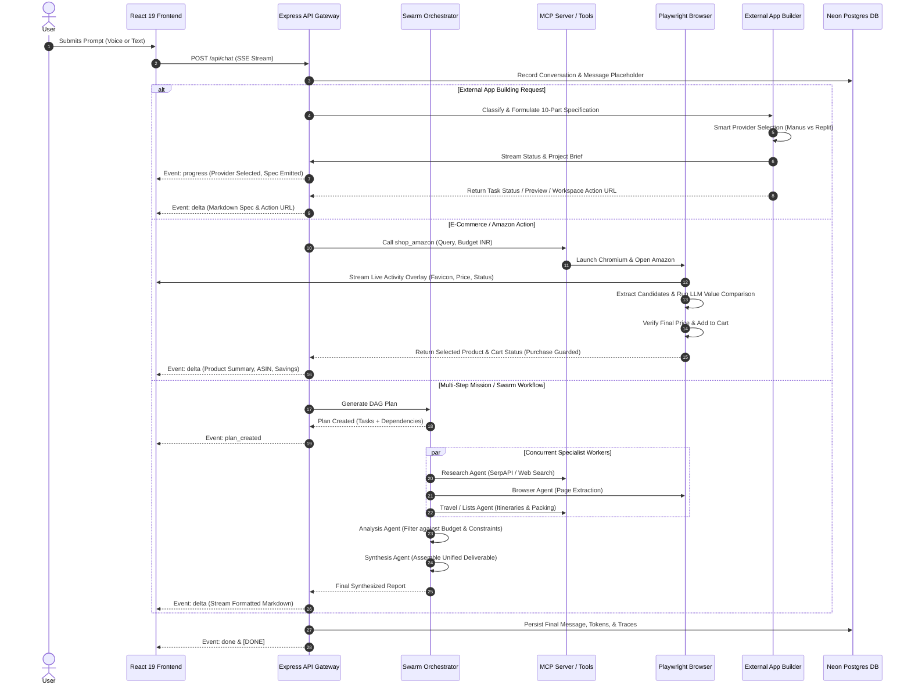
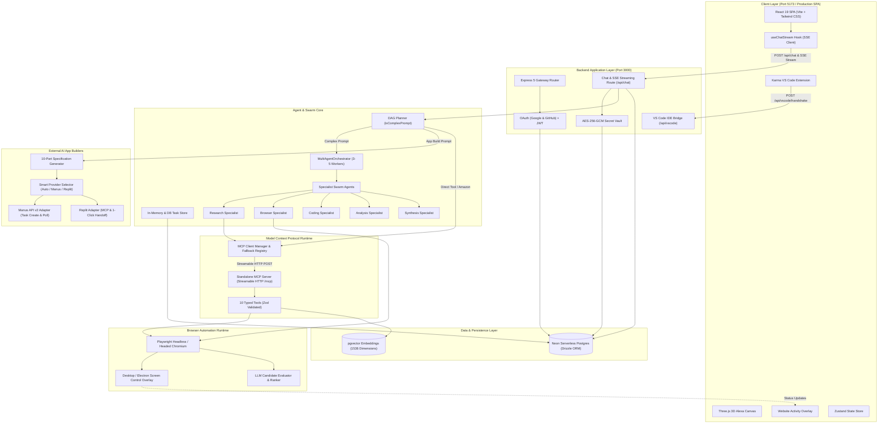
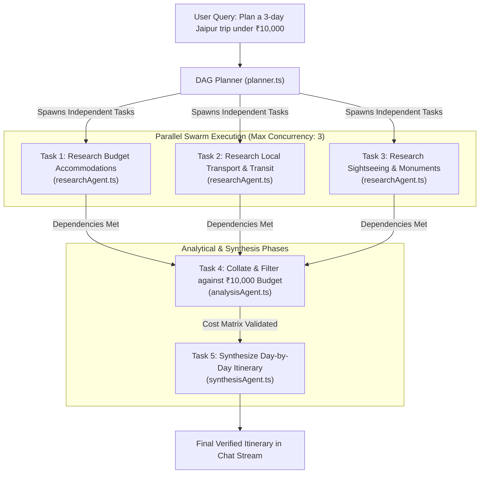

# Karma

> An autonomous action assistant and multi-agent swarm that transforms natural-language intents into coordinated real-world workflows across MCP tools, Playwright browser automation, and external AI app builders.

[](LICENSE)
[](https://nodejs.org)
[](https://www.typescriptlang.org)
[](https://react.dev)
[](https://expressjs.com)
[](https://modelcontextprotocol.io)
[](https://playwright.dev)
[](https://orm.drizzle.team)
[](https://neon.tech)

---

## Overview

Traditional conversational chatbots generate text from static model weights, leaving users to manually coordinate multiple browser tabs, search engines, developer tools, and e-commerce checkouts. When a task requires multiple steps, external website interactions, or software scaffolding, text generation alone is insufficient.

**Karma** bridges conversational AI and real-world execution. Built around an agentic orchestrator, a standalone Model Context Protocol (MCP) server, Playwright browser automation with real-time screen-control overlays, and integrations with external AI app builders (Manus and Replit), Karma plans, parallelizes, executes, and surfaces verifiable results directly in a unified streaming interface.

```
+-------------------------------------------------------------------------------------------------+
|                                       Karma Architecture                                       |
|                                                                                                 |
|   User Prompt / Voice Ingest                                                                    |
|              |                                                                                  |
|              v                                                                                  |
|   [React 19 Frontend + 3D Device Canvas + Live Telemetry Overlay]                               |
|              |                                                                                  |
|              | SSE Event Stream (/api/chat) & WebSocket / IDE Bridge                            |
|              v                                                                                  |
|   [Express 5 API Gateway + Session Store + AES-256 Secret Vault]                                |
|              |                                                                                  |
|       +------+-----------------------------+-------------------------------+                    |
|       |                                    |                               |                    |
|       v                                    v                               v                    |
|   [Swarm Orchestrator]             [Standalone MCP Server]        [External App Builders]       |
|   - DAG Task Planner               - 10 Typed Tools               - Manus AI v2 API             |
|   - Bounded Concurrency (3-5)      - Streamable HTTP & SSE        - Replit Agent Handoff        |
|   - 5 Specialist Agents            - SerpAPI / India Shopping     - 10-Part Spec Engine         |
|   - Task Store & Memory            - Home / Travel / Notes        - Mock Payment Safeguard      |
|       |                                    |                                                    |
|       +-----------------+------------------+                                                    |
|                         |                                                                       |
|                         v                                                                       |
|             [Playwright Browser Automation]                                                     |
|             - Headless / Headed Chromium                                                        |
|             - Amazon Search, Extract, Compare, & Cart Add                                       |
|             - Live Activity Overlay with Safe Purchase Stop                                     |
+-------------------------------------------------------------------------------------------------+
```

---

## Media and Demonstration Walkthrough

| Interface Component | Role in Karma |
| :--- | :--- |
| **Unified Chat & Swarm View** | Live execution stream with token delta, DAG progress cards, and tool traces |
| **Interactive 3D Device Canvas** | Three.js rendering of Alexa Echo device for ambient voice interactions |
| **Live Website Activity Overlay** | Desktop and web floating overlay showing live browser navigation, domain favicon, extracted INR prices, and abort controls |
| **VS Code IDE Bridge** | Bi-directional extension synchronizing workspace diagnostics, active editor tabs, and terminal tasks |

*Note: For judges evaluating the submission, an end-to-end recording link can be configured at `docs/assets/karma-demo.mp4` or viewed via the local reproduction test scripts detailed below.*

---

## The Problem

1. **Context Fragmentation**: Accomplishing complex goals (e.g. researching travel itineraries within a specific budget, finding best-value supplements, or building a prototype) forces users to switch between search engines, spreadsheets, code editors, and retailer websites.
2. **Hallucination vs. Verification**: Standard LLM chat interfaces invent inventory, hallucinate pricing, and provide non-executable instructions without real-world feedback loops.
3. **Lack of Standard Tooling**: Integrating custom tools into proprietary agent frameworks creates fragile, non-reusable glue code.
4. **Safety and Oversight Gaps**: Purely autonomous agents risk triggering unintended financial transactions or running unchecked code in local environments.

---

## How Karma Solves It

- **Deterministic DAG Planning**: Complex prompts are decomposed into Directed Acyclic Graphs (DAGs) with explicit dependencies, executing independent tasks concurrently while synchronizing analytical and synthesis phases.
- **Model Context Protocol (MCP) Standards**: Capabilities are exposed via an independent MCP server implementing the `2025-11-25` specification, consumable by Karma or any external MCP-compliant client.
- **Real-World Browser Automation**: Playwright drives real web pages, extracts live candidate data, verifies prices dynamically, and navigates checkout funnels up to final review without placing live orders.
- **External AI App Builder Delegation**: Software development requests automatically trigger a 10-part architectural brief generator, routing to headless Manus task execution or Replit template handoffs.
- **Zero-Trust Security & BYOK**: User API credentials (OpenRouter, Groq, Manus, SerpAPI) are encrypted at rest with AES-256-GCM on Neon Postgres and never exposed to client browsers. Consequential actions (payment charging, public deployment) require explicit user confirmation.

---

## How It Works



### Execution Stages

1. **Input Ingest & Intent Classification**: The frontend streams user requests to `/api/chat`. The backend router checks if the request represents an e-commerce shopping action, an app-building specification, or a multi-step research mission.
2. **Orchestration & Task Delegation**:
   - Single-turn queries call the relevant MCP tool directly.
   - App building requests trigger the `AppBuilderService` to generate a 10-part production brief and dispatch tasks to Manus or Replit.
   - Complex missions launch the `MultiAgentOrchestrator`, building a DAG with up to 5 concurrent workers.
3. **Execution & Feedback**: Tools and browser agents stream real-time lifecycle events (`planning`, `executing_tool`, `controlling_screen`, `delta`) to the UI via Server-Sent Events (SSE).
4. **Result Synthesis**: Outputs are aggregated, cross-referenced, and formatted as structured Markdown tables, action callouts, and interactive visual panels.

---

## Technical Architecture



### Key Entry Points and Directory Map

```
Karma/
├── backend/
│   ├── src/
│   │   ├── index.ts                      # Express server entry point, CORS, and route mounts
│   │   ├── config.ts                     # Environment configuration and defaults
│   │   ├── agent/
│   │   │   ├── orchestrator/
│   │   │   │   ├── orchestrator.ts       # MultiAgentOrchestrator DAG executor
│   │   │   │   ├── planner.ts            # Intent classification and dependency DAG planner
│   │   │   │   ├── taskStore.ts          # Task lifecycle and metadata persistence
│   │   │   │   └── agents/               # Research, Browser, Coding, Analysis, Synthesis
│   │   │   └── prompts.ts                # System prompts and tool instruction schemas
│   │   ├── db/
│   │   │   ├── index.ts                  # Neon Postgres connection pool
│   │   │   └── schema.ts                 # Drizzle schema (users, secrets, conversations, tasks)
│   │   ├── mcp/
│   │   │   ├── server.ts                 # Standalone MCP Server exposing 10 tools on /mcp
│   │   │   └── client.ts                 # MCP client manager and execution dispatcher
│   │   ├── routes/
│   │   │   ├── chat.routes.ts            # Main SSE streaming chat route with direct intent hooks
│   │   │   ├── vscode.routes.ts          # VS Code extension protocol bridge
│   │   │   ├── workspace.routes.ts       # Project file scanning and file operations
│   │   │   └── terminal.routes.ts        # Sandboxed command execution
│   │   ├── services/
│   │   │   └── appBuilder/               # External AI app builder adapters (Manus & Replit)
│   │   │       ├── types.ts              # Typed provider interfaces and spec definitions
│   │   │       ├── specificationBuilder.ts # 10-part specification generator
│   │   │       ├── manusAdapter.ts       # Official Manus API v2 task management
│   │   │       ├── replitAdapter.ts      # Replit remote MCP and guided handoff
│   │   │       ├── providerSelector.ts   # Capability and override routing layer
│   │   │       └── appBuilderService.ts  # End-to-end build coordinator
│   │   └── tools/
│   │       └── shopping/
│   │           ├── amazonShoppingAgent.ts # Playwright automation with purchase safeguards
│   │           ├── productAgent.ts       # LLM candidate evaluation and ranking
│   │           └── searchProducts.ts     # SerpAPI product search
│   └── test/                             # Acceptance, swarm, unit, and integration test suites
├── frontend/
│   └── app/
│       ├── src/
│       │   ├── App.tsx                   # Main React SPA layout
│       │   ├── components/
│       │   │   ├── PromptBox.tsx         # User input, voice toggle, builder selector
│       │   │   ├── WebsiteActivityOverlay.tsx # Live browser activity overlay
│       │   │   ├── UnifiedSwarmPanel.tsx # Swarm task graph and progress monitor
│       │   │   ├── AlexaViewer.tsx       # Three.js 3D Alexa device canvas
│       │   │   └── MessageBubble.tsx     # Markdown renderer with tool call badges
│       │   ├── hooks/
│       │   │   └── useChatStream.ts      # SSE stream parser and lifecycle event handler
│       │   └── store/
│       │       └── appStore.ts           # Zustand global state store
└── vscode-extension/                     # Bi-directional IDE extension
```

---

## Model Context Protocol (MCP) Integration

Karma exposes its capabilities through an independent Model Context Protocol server adhering to the `2025-11-25` specification. The MCP server runs on port 3000 under the Streamable HTTP transport (`/mcp`) and Server-Sent Events transport (`/sse`).

### Registered Tools

| Tool Name | Capability Description | Input Parameters | Output Format | External Dependencies | Required Credentials | Current Limitations |
| :--- | :--- | :--- | :--- | :--- | :--- | :--- |
| `shop_amazon` | Automates Amazon.in product search, candidate ranking, live price checks, and cart additions up to checkout review. | `query` (string), `maxPriceINR` (number), `requirements` (string) | JSON with selected candidate, price verification, cart URL, ASIN, and safeguard notice | Playwright, Chromium, Amazon.in | None (Browser driven) | Stops before purchase confirmation; Amazon CAPTCHA may require manual solve in headed mode. |
| `build_external_app` | Delegates software creation to external AI builders, generating a 10-part specification with mock payment policy. | `prompt` (string), `provider` ('auto' \| 'manus' \| 'replit') | JSON with provider rationale, task status, project URL, preview link, and handoff actions | Manus API v2, Replit | `MANUS_API_KEY` (optional, for Manus API); Replit falls back to guided handoff | Replit unauthenticated mode provides guided workspace links rather than direct remote builds. |
| `search_products` | Searches shopping products with INR price filtering. | `query` (string), `maxPriceINR` (number), `limit` (number) | JSON array of matched products with title, price, thumbnail, and source link | SerpAPI Google Shopping Engine | `SERPAPI_KEY` | Bounded to 10 results per query. |
| `manage_lists` | Queries, creates, adds, and updates personal lists and checklists. | `action` (string), `filter` (string), `title` (string), `items` (string[]) | JSON with matching lists, active counts, and updated checklist items | In-memory / Database | None | Currently stores active session lists in memory. |
| `travel_planner` | Coordinates travel itineraries, packing lists, flight options, and hotels. | `destination_query` (string), `mode` (string) | JSON travel plan with highlights, duration, and packing items | Internal planning engine | None | Output provides structured estimates; real booking requires browser automation. |
| `home_assistant_core` | Interacts with smart devices and automated home routines. | `query` (string), `device` (string), `state` (string) | JSON with device name, applied state, and speakable confirmation message | Simulated Smart Home state machine | None | Virtual simulation; physical IoT bridges require local Home Assistant endpoint. |
| `knowledge_retrieval` | Performs RAG retrieval from user-indexed personal knowledge documents. | `subject` (string), `depth` (string) | JSON with source documents, page numbers, passage snippets, and similarity scores | Vector Store / pgvector | None (Local DB) | Requires documents to be indexed first via `rag_ingest`. |
| `rag_ingest` | Ingests PDF, Markdown, and text documents into the vector store. | `file_path` (string), `content` (string) | JSON confirming chunks created, bytes indexed, and collection status | Chunking engine, pgvector | Database connection | Large PDFs (>50MB) require chunked streaming ingestion. |
| `creative_studio` | Generates conceptual outlines, structured routines, and creative concepts. | `prompt` (string), `style` (string) | JSON with concept title, structured elements, and ambient lighting/audio cues | Internal heuristic engine | None | Text-based structured suggestions. |
| `maps_search` | Resolves places and walking routes using geographic location data. | `query` (string), `location` (string) | JSON array of nearby places with addresses, distances, and coordinates | Geocoding service | None | Interactive map tile rendering requires frontend Leaflet mounting. |

---

## Multi-Agent Orchestration

When a request requires multi-domain coordination, Karma's `MultiAgentOrchestrator` generates an execution DAG.



### Specialist Agent Responsibilities

1. **`researchAgent`**: Queries search engines (SerpAPI/Serper) and web sources to gather up-to-date facts, hours, and prices.
2. **`browserAgent`**: Uses Playwright to interact with live websites, read dynamic DOM elements, and take screenshots.
3. **`codingAgent`**: Inspects workspace files, analyzes syntax, executes terminal tests, and applies code modifications.
4. **`analysisAgent`**: Performs mathematical evaluations, budget constraints filtering, and candidate comparison tables.
5. **`synthesisAgent`**: Reconciles findings from all upstream tasks into an authoritative, cited report.

---

## Use Cases

### 1. E-Commerce Shopping Automation with Live Desktop Overlay
- **User Prompt**: `"Find creatine monohydrate on Amazon under 500 rupees and add it to cart"`
- **Workflow**:
  1. Karma's intent router classifies the prompt as a shopping action and invokes the `shop_amazon` tool.
  2. Playwright launches Chromium and navigates to Amazon.in.
  3. The `WebsiteActivityOverlay` appears in the UI, showing the active domain, favicon, extracted product prices, and a real-time countdown timer.
  4. The `productAgent` evaluates candidate listings using LLM reasoning to balance price, review count, and purity per serving against the 500 INR budget.
  5. The browser navigates to the selected product page, confirms the live price is within the budget, and adds the item to the cart.
  6. The workflow stops at the cart review page, returning the itemized breakdown, verified price, and ASIN.
- **Status**: Fully automated up to cart addition; purchase placement requires user confirmation.

### 2. Multi-Agent Parallel Travel Swarm
- **User Prompt**: `"Plan a 3-day trip to Jaipur under ₹10,000 with travel, hotel, and sightseeing"`
- **Workflow**:
  1. The DAG planner identifies budget, travel, and schedule constraints, generating a 5-task execution plan.
  2. Tasks 1, 2, and 3 run concurrently across three worker threads to research budget hostels, public transport options, and monument entrance fees.
  3. The `analysisAgent` evaluates total costs against the 10,000 INR ceiling.
  4. The `synthesisAgent` emits a day-by-day itinerary with verified timings, cost breakdowns, and emergency contacts.
- **Status**: Fully automated end-to-end. Verified in `backend/test/test_jaipur_swarm_mission.ts`.

### 3. External AI App Builder Delegation
- **User Prompt**: `"Create a responsive food delivery app with customer authentication, restaurant listings, search, cart, checkout, order tracking, and an admin dashboard."`
- **Workflow**:
  1. The request is classified as an application building task.
  2. The `specificationBuilder` compiles a 10-part specification with architectural requirements, data models, and a **Sandbox Payment Safeguard**.
  3. The `providerSelector` checks credentials:
     - When `MANUS_API_KEY` is present, dispatches directly to Manus API v2 (`task.create`) and polls for task completion.
     - When unauthenticated, routes to Replit Agent with a 1-click workspace template (`https://replit.com/new/react-vite-ts`) and the full prompt ready to paste.
  4. Karma streams progress updates and renders a status card containing the workspace link and environment setup instructions.
- **Status**: End-to-end automated brief generation and Manus API dispatch. Replit operates via verified honest guided handoff. Verified in `backend/test/test_app_builder.ts`.

### 4. VS Code IDE Integration and Workspace Sync
- **User Prompt**: Triggered via the Karma VS Code Extension (`karma.sendWorkspace`).
- **Workflow**:
  1. Extension establishes an authenticated handshake with `/api/vscode/handshake`.
  2. Synchronizes workspace directory trees, active editor selections, and language diagnostic errors.
  3. The `codingAgent` analyzes diagnostics and streams refactored code snippets or bug fixes directly back into the editor view.
- **Status**: Implemented protocol bridge (`backend/src/routes/vscode.routes.ts`) and extension manifest.

---

## Why Karma?

- **Real Actions Over Text Hallucinations**: Karma drives browsers, calls MCP tools, and triggers app builders instead of merely writing speculative paragraphs.
- **Unified Ecosystem via MCP**: Uses the open Model Context Protocol specification rather than proprietary, hardcoded tool connectors.
- **Explicit Safety Boundaries**: Financial transactions and deployments require human confirmation. Sensitive user keys are encrypted with AES-256-GCM.
- **Live Observability**: Every execution phase, tool call, and token is streamed transparently to the user interface in real time.

---

## Getting Started

### Prerequisites
- **Node.js**: `>= 20.0.0`
- **npm**: `>= 10.0.0`
- **Database**: PostgreSQL (Neon serverless recommended)
- **Browser Automation**: Playwright with Chromium binaries installed

### Installation

1. Clone the repository:
   ```bash
   git clone https://github.com/shivam7-gif/Karma.git
   cd Karma
   ```

2. Install root and workspace dependencies:
   ```bash
   npm install
   npm --prefix backend install
   npm --prefix frontend/app install
   ```

3. Install Playwright browser dependencies:
   ```bash
   npx playwright install chromium
   ```

### Environment Configuration

Copy the example environment configuration in the backend:
```bash
cp backend/.env.example backend/.env
```

Configure the following variables in `backend/.env`:

| Variable Name | Required? | Purpose | Source / How to Obtain |
| :--- | :--- | :--- | :--- |
| `DATABASE_URL` | **Yes** | Pooled PostgreSQL connection string | [Neon Console](https://neon.tech) |
| `SECRETS_MASTER_KEY` | **Yes** | 64-character hex master key for AES-256 encryption | Generate with `openssl rand -hex 32` |
| `PORT` | No | Backend API port (defaults to `3000`) | Standard port configuration |
| `FRONTEND_URL` | No | Frontend origin for CORS validation (defaults to `http://localhost:5173`) | Local or deployed frontend URL |
| `OPENROUTER_FALLBACK_KEY` | No | Server fallback LLM inference key | [OpenRouter](https://openrouter.ai/keys) |
| `SERPAPI_KEY` | No | Required for Google Shopping search (`search_products`) | [SerpAPI](https://serpapi.com) |
| `MANUS_API_KEY` | No | Required for autonomous Manus app generation | [Manus Developer Portal](https://open.manus.ai) |
| `REPLIT_AUTH_TOKEN` | No | Optional OAuth token for remote Replit MCP | [Replit Docs](https://docs.replit.com) |

*Note: Karma functions in local demo mode without optional third-party keys. In the absence of a `MANUS_API_KEY`, app creation requests gracefully route to the Replit guided handoff workflow.*

### Database Initialization

Generate and run Drizzle migrations:
```bash
npm --prefix backend run db:migrate
```

### Running the Application

Open separate terminal windows for the backend, MCP server, and frontend:

1. **Start the Backend API Service**:
   ```bash
   npm --prefix backend run dev
   ```
   *Runs on `http://localhost:3000` with routes mounted on `/api/*` and health check at `/health`.*

2. **Start the Standalone MCP Server (Optional if testing isolated MCP clients)**:
   ```bash
   npm --prefix backend run dev:mcp
   ```
   *Runs the MCP Streamable HTTP endpoint on `http://localhost:3000/mcp`.*

3. **Start the Frontend Client**:
   ```bash
   npm --prefix frontend/app run dev
   ```
   *Runs on `http://localhost:5173` with real-time SSE streaming connected to the backend.*

---

## Reproducible Test and Verification Suite

Karma includes an automated test suite verifying each subsystem:

```bash
# 1. External AI App Builder Acceptance Suite (7/7 Tests)
npm --prefix backend run test:app-builder

# 2. Interactive App Builder Live Prompt Test
npm --prefix backend run test:prompt

# 3. Multi-Agent Swarm Mission Test (Jaipur Trip with 3 Concurrent Workers)
npx tsx --env-file=backend/.env backend/test/test_jaipur_swarm_mission.ts

# 4. End-to-End Agent System & Tool Discovery Test
npx tsx --env-file=backend/.env backend/test/test_agent_system_e2e.ts

# 5. Amazon Playwright Shopping & Overlay Test
npm --prefix backend run test:amazon
```

---

## Security, Privacy, and Limitations

- **Credential Security**: All user-provided API keys (BYOK) are encrypted before database insertion using AES-256-GCM with randomized initialization vectors and authentication tags. Encryption keys never leave the server.
- **Financial Safeguards**: Automated shopping workflows navigate through search, comparison, and cart addition, but explicitly halt before final checkout submission. Live payment credentials are never automated.
- **External Builder Honesty**: The Replit adapter does not claim automated background deployment when operating without an authorized MCP OAuth token; it generates the complete brief and opens an official template deep-link for user review.
- **Browser Automation Sandboxing**: Playwright instances operate within isolated browser contexts. In headless production environments, visual progress is streamed via structured metadata events rather than raw remote frame captures.

---

## Current Status and Roadmap

### Implemented & Verified
- Standalone Model Context Protocol server exposing 10 typed tools over Streamable HTTP and SSE.
- Multi-agent swarm orchestrator with DAG planning and bounded concurrency.
- Playwright-driven Amazon product comparison and cart automation with purchase stop.
- Live website activity overlay and Three.js 3D Alexa visualizer.
- External AI app builder integration supporting Manus API v2 and Replit guided workflows.
- Neon Postgres persistence for conversations, messages, tasks, and encrypted secrets.

### Partially Implemented / In Progress
- Leaflet map rendering for `maps_search` outputs on the frontend.
- Direct OAuth 2.0 flow for remote Replit MCP connections.

### Planned Capabilities
- Multi-turn voice interaction via WebRTC audio streaming.
- Local Home Assistant discovery via mDNS.

---

## Contributing

1. Fork the repository and create a feature branch (`git checkout -b feature/new-capability`).
2. Ensure all changes adhere to existing TypeScript configurations and pass test suites (`npm --prefix backend run test:app-builder` and `npm --prefix backend run build`).
3. Commit your updates (`git commit -m "feat: implement capability"`).
4. Push to your branch and submit a Pull Request.

---

## License

This project is licensed under the [MIT License](LICENSE).
