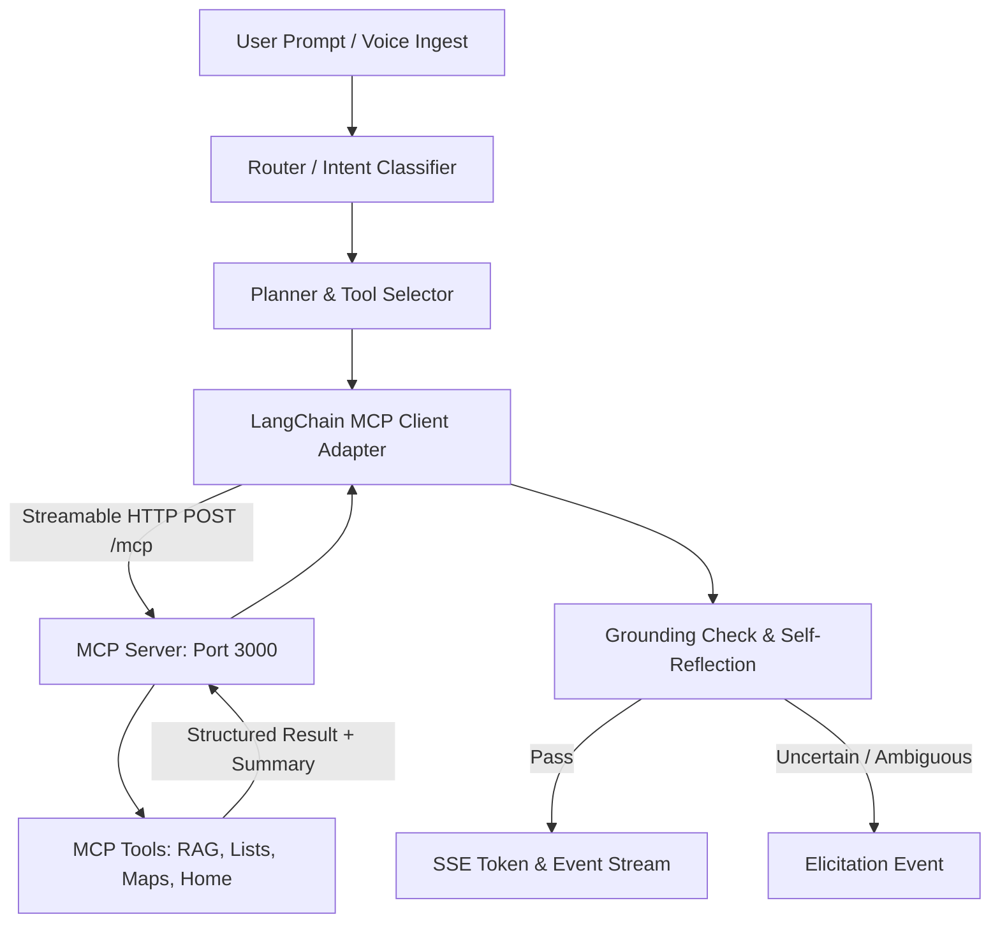

[//]: # (PROJECT_NAME=Karma)

# Karma

> Your documents, your plans, your world: ask once, and Karma reads, reasons, maps and gets it done.

[](LICENSE)
[](https://nodejs.org)
[](https://www.typescriptlang.org)
[](https://modelcontextprotocol.io)

<!-- Demo GIF Placeholder -->
<!-- TODO: Add recording of voice interaction, elicitation card, and live trace panel -->
<!-- Demo Video Link Placeholder: https://example.com/karma-demo -->

Karma is a voice-first personal AI assistant built on open standards. Every ability is a small, well-described MCP tool served over Streamable HTTP: answering questions from the user's own documents with cited sources (RAG), finding places and planning routes on an interactive map, turning any topic or document into a mind map or word cloud, managing lists, reminders and notes, and controlling a simulated smart home. An agentic AI engine plans multi-step requests, calls the tools, checks its own answers, and shows its work in a live trace. A bundled Agent Skill teaches any compatible agent how to use the tools well.

---

## Why Karma exists

Assistants answer from generic knowledge, can't act on a person's own material, and can't show their reasoning or anything visual. People need an assistant that knows their documents, plans multi-step tasks, and shows maps and diagrams when words are not enough. Karma bridges this gap by grounding conversational actions in personal documents, executing multi-step workflows through standardized Model Context Protocol (MCP) tools, and streaming real-time execution traces directly to the screen.

---

## What you can ask it

The following table reflects capabilities supported in the client simulation and planned backend tools:

| Capability | Example Request | Tool(s) Involved | Visual Produced |
| :--- | :--- | :--- | :--- |
| **Everyday Tools** | *"What's on my shopping list?"* | `manage_lists` | Interactive lists panel ([`ListPanel.tsx`](frontend/app/src/components/ListPanel.tsx)) |
| **Simulated Smart Home** | *"Turn down the living room lights"* | `home_assistant_core` | Status card & audio confirmation |
| **Agentic / Travel** | *"Plan a 3-day getaway to Maui"* | `travel_planner` | Elicitation options card ([`ElicitationCard.tsx`](frontend/app/src/components/ElicitationCard.tsx)) |
| **Knowledge / Retrieval** | *"Explain voice UI latency guidelines"* | `knowledge_retrieval` | Message bubble with real-time token stream |
| **Creative / Brainstorming** | *"Create an evening acoustic routine"* | `creative_studio` | Formatted suggestion text block |
| **Maps** | *"Find coffee shops near Powell St and map a walk"* | `maps_search`, `maps_route` <!-- TODO: Backend implementation pending --> | Leaflet interactive map <!-- TODO: UI renderer pending --> |
| **Mind Maps & Clouds** | *"Generate a mind map from my project plan"* | `generate_mindmap` <!-- TODO: Backend implementation pending --> | Graph view <!-- TODO: UI renderer pending --> |
| **Multi-Step Workflows** | *"Plan a trip from my notes, map it, and add a packing list"* | `knowledge_retrieval`, `travel_planner`, `manage_lists` | Elicitation card + trace stream |

---

## How Karma uses MCP and Agent Skills

Karma exposes capabilities through modular tools adhering to the Model Context Protocol (spec `2025-11-25`). In the current codebase, tool interfaces are tested via frontend contract mock streams ([`frontend/app/src/api/mock.ts`](frontend/app/src/api/mock.ts)) and scheduled for implementation in the standalone Express MCP server ([`backend/mcp/server.ts`](backend/mcp/server.ts)).

| Tool Name | Purpose | Inputs | Elicitation? | Source File |
| :--- | :--- | :--- | :--- | :--- |
| `manage_lists` | Queries and modifies personal lists and checklists | `action: string`, `filter: string` | No | [`frontend/app/src/api/mock.ts`](frontend/app/src/api/mock.ts) |
| `travel_planner` | Coordinates destinations, itineraries, and packing | `destination_query: string`, `mode: string` | **Yes** (destinations/dates) | [`frontend/app/src/api/mock.ts`](frontend/app/src/api/mock.ts) |
| `home_assistant_core` | Interacts with virtual smart devices and routines | `query: string` | No | [`frontend/app/src/api/mock.ts`](frontend/app/src/api/mock.ts) |
| `knowledge_retrieval` | RAG retrieval from user-indexed personal knowledge | `subject: string`, `depth: string` | No | [`frontend/app/src/api/mock.ts`](frontend/app/src/api/mock.ts) |
| `creative_studio` | Generates outlines and structured conceptual content | `prompt: string`, `style: string` | No | [`frontend/app/src/api/mock.ts`](frontend/app/src/api/mock.ts) |
| `rag_ingest` | Ingests PDF, text, and markdown into vector store | `file_path: string`, `content: string` | No | `<!-- TODO: backend/src/mcp/tools/rag.ts -->` |
| `maps_search` | Resolves places and routes using OpenStreetMap data | `query: string`, `location: object` | No | `<!-- TODO: backend/src/mcp/tools/maps.ts -->` |

### Agent Skill Integration

An Agent Skill (`skills/karma/SKILL.md` <!-- TODO: Create bundled skills/ directory -->) guides external agents to format responses for ambient voice playback: emit concise speakable summaries, favor one-shot parameter extraction, trigger interactive elicitation cards for ambiguities, and delegate heavy data rendering to the screen.

---

## The AI engine

The backend engine (`backend/src/engine`) leverages LangGraph ([`@langchain/langgraph`](backend/package.json)) and `@langchain/mcp-adapters` to orchestrate tool invocations via the independent MCP server.



- **Chat & Planner Model:** Configured via AWS Bedrock (`@langchain/aws` 1.4.6) with Claude 3.5 Sonnet (`anthropic.claude-3-5-sonnet-20241022-v2:0` <!-- TODO: Verify deployment model id in production -->).
- **RAG & Embeddings:** Planned Bedrock Titan Text Embeddings (`amazon.titan-embed-text-v2:0` <!-- TODO: Verify embedding model in backend/src/engine -->).
- **Chunking Strategy:** 500-token chunks with 50-token overlap <!-- TODO: Implement chunking logic in backend/src/engine/rag.ts -->.
- **Retrieval & Reranking:** Hybrid BM25 + dense vector similarity with score thresholding <!-- TODO: Implement hybrid retriever and reranker -->.
- **Citations:** Structured document filename, passage index, and score returned in tool payload.

---

## Architecture

```mermaid
flowchart LR
    Browser["React 19 + Vite Frontend\n(Web Speech API, Three.js)"]
    API["Express API Gateway\n(Port 4000, SSE /api/chat)"]
    Engine["AI Engine\n(LangGraph Agent & State Checkpointer)"]
    MCPAdapter["LangChain MCP Client\n(@langchain/mcp-adapters)"]
    MCPServer["Karma MCP Server\n(Port 3000, Streamable HTTP /mcp)"]
    VectorStore[("Local Vector Store\n(Documents & Metadata)")]

    Browser -->|POST /api/chat & SSE Stream| API
    API --> Engine
    Engine --> MCPAdapter
    MCPAdapter -->|Streamable HTTP POST| MCPServer
    MCPServer --> VectorStore
```



The MCP server runs as a standalone process completely decoupled from the AI agent loop. Because it exposes a standard Streamable HTTP endpoint on `/mcp`, any MCP-compliant client (Claude Desktop, IDE agents, custom microservices) can connect directly and utilize Karma's document retrieval, smart lists, and simulation tools without depending on the front-end or LangGraph runtime.

---

## Voice-first design

- **One-Shot Parameter Extraction:** Natural voice sentences are parsed in a single turn to avoid conversational friction.
- **Elicitation for Disambiguation:** When required inputs are missing, an `elicitation` event streams to the client, rendering actionable choice buttons ([`ElicitationCard.tsx`](frontend/app/src/components/ElicitationCard.tsx)).
- **Headless vs. Screen Mode:** The client toggles between `voice-only` and `screen` device profiles ([`DeviceToggle.tsx`](frontend/app/src/components/DeviceToggle.tsx)), adapting responses between pure spoken summaries and rich visual cards.
- **Speakable Summaries:** Tools provide clean, pronunciation-friendly text alongside complex JSON payloads for browser speech synthesis ([`useSpeech.ts`](frontend/app/src/hooks/useSpeech.ts)).
- **Structured Error Follow-ups:** Tool execution issues stream back structured diagnostics so the engine can ask clarifying questions instead of failing silently.

---

## Quick start

### Prerequisites
- Node.js `>= 20.0.0`
- npm `>= 10.0.0`
- Optional: AWS Credentials configured for Bedrock inference

### Installation

```bash
# Clone the repository
git clone https://github.com/shivam7-gif/Karma.git
cd Karma

# Install backend dependencies
cd backend && npm install

# Install frontend dependencies
cd ../frontend/app && npm install
cd ../..
```

### Environment Configuration

Copy [.env.example](.env.example) to `backend/.env` and configure credentials:
```bash
cp .env.example backend/.env
```
Environment variables referenced in the project:
`MCP_PORT`, `API_PORT`, `MCP_URL`, `AWS_REGION`, `AWS_ACCESS_KEY_ID`, `AWS_SECRET_ACCESS_KEY`, `VITE_USE_MOCK`, `VITE_API_ENDPOINT`.

### Running the Services

Open three terminal windows to run the components independently:

```bash
# 1. MCP Tool Server (Port 3000)
cd backend && npm run dev:mcp

# 2. AI Engine & API Gateway (Port 4000)
cd backend && npm run dev:api

# 3. React Frontend Client (Port 5173)
cd frontend/app && npm run dev
```

To inspect the standalone MCP server, launch the [MCP Inspector](https://github.com/modelcontextprotocol/inspector):
```bash
npx @modelcontextprotocol/inspector http://localhost:3000/mcp
```

<!-- TODO: Add document ingestion CLI command, e.g., npm run ingest:docs <path-to-folder> -->

---

## Using Karma

1. **RAG with Citations:**
   - *Prompt:* `"What was our agreed budget ceiling in the Q3 operations review?"`
   - *Result:* Token-streamed answer citing `q3_ops_review.pdf (Page 4, Paragraph 2)`.
2. **Interactive Map:**
   - *Prompt:* `"Find three quiet cafes near Mission Dolores and map the route."`
   - *Result:* Spoken summary plus map card plotted with OpenStreetMap coordinates.
3. **Mind Map Generation:**
   - *Prompt:* `"Turn my travel notes for Japan into a mind map."`
   - *Result:* Visual hierarchical node graph showing transport, lodging, and activities.
4. **Multi-Step Request:**
   - *Prompt:* `"Plan a trip from my notes, map it, and add a packing list."`
   - *Result:* Reads notes via retrieval, triggers `travel_planner`, populates `ListPanel.tsx`, and streams execution steps in `TracePanel.tsx`.
5. **Interactive Elicitation:**
   - *Prompt:* `"Help me pack for my vacation."`
   - *Result:* Voice asks *"Which trip would you like to plan right now?"* and presents options: `[Maui Packing, London Trip, Weekend Camping]`.

---

## Repository layout

```text
├── .env.example                  # Safe template for environment variables
├── .gitignore                    # Exclusion rules for env, dist, and modules
├── LICENSE                       # MIT License
├── README.md                     # Project documentation
├── backend/
│   ├── .env                      # Local backend configuration (git-ignored)
│   ├── package.json              # Express, LangChain Bedrock, LangGraph, MCP SDK
│   ├── tsconfig.json             # ES2022 NodeNext TypeScript configuration
│   ├── mcp/
│   │   └── server.ts             # Streamable HTTP MCP server entry point
│   └── src/
│       └── index.ts              # Express API server entry point
├── frontend/
│   └── app/
│       ├── package.json          # React 19, Three.js, Lucide, Zustand, Vite
│       ├── vite.config.ts        # Vite build & dev server configuration
│       └── src/
│           ├── api/              # SSE streaming client, contracts, and mock engine
│           ├── components/       # UI shell, 3D AlexaViewer, VoiceOrb, TracePanel
│           ├── hooks/            # Web Speech API & chat stream hooks
│           ├── pages/            # Landing, Login, Signup, and Dashboard
│           └── store/            # Zustand state management
└── skills/                       <!-- TODO: Add karma/SKILL.md for agent guidance -->
```

---

## Evaluation

<!-- TODO: Implement benchmark suite for RAG retrieval accuracy and citation precision -->
Formal evaluation metrics (Faithfulness, Answer Relevance, Context Recall) will be published once automated evaluation datasets are integrated into CI.

---

## Testing

Backend test suites are powered by [Vitest](https://vitest.dev/):

```bash
# Run backend test suite
cd backend && npm run test

# Run tests in watch mode
cd backend && npm run test:watch
```

Current test suites cover:
- Tool parameter schema validation (`zod`)
- Stream event serialisation and parsing
- <!-- TODO: Add test/rag.test.ts for chunking and vector retrieval -->
- <!-- TODO: Add test/mcp.test.ts for Streamable HTTP SSE transport -->

---

## Limitations and roadmap

- **Simulated Smart Home:** All device switches and routines are virtual simulations and do not interact with physical IoT protocols (Matter/Zigbee).
- **Backend Implementation:** The MCP server and LangGraph engine are currently under active porting from prototype contracts; the frontend provides a complete mock simulator for offline development (`VITE_USE_MOCK=true`).
- **Roadmap:**
  - Complete native RAG vector pipeline using hybrid search.
  - Implement Leaflet and OpenStreetMap rendering components in `frontend/app`.
  - Add SVG/Canvas mind-map and word-cloud visualization cards.
  - Integrate real calendar and timer MCP tool endpoints.
  - Package the official `skills/karma/SKILL.md` skill definition.

---

## Security notes

- **Secrets Handling:** API keys and AWS credentials are read exclusively on the server via `.env` and are never exposed to the frontend bundle.
- **Client Sanitisation:** User prompt inputs and streamed SSE payloads are parsed with explicit schema validation before rendering.
- **Origin Checking:** The backend Express server enforces CORS origin filtering ([`backend/src/index.ts`](backend/src/index.ts)).
- **Document Limits:** File ingestion is restricted to verified MIME types (`application/pdf`, `text/markdown`, `text/plain`) <!-- TODO: Enforce max 25MB upload payload ceiling in API gateway -->.

---

## Contributing, License, Acknowledgements

Contributions are welcome via pull requests following standard Git feature-branch workflows.

### License
This project is licensed under the [MIT License](LICENSE).

### Acknowledgements
- [Model Context Protocol (MCP)](https://modelcontextprotocol.io/) by Anthropic.
- [LangChain](https://www.langchain.com/) and [LangGraph](https://langchain-ai.github.io/langgraph/) by LangChain AI.
- [OpenStreetMap](https://www.openstreetmap.org/copyright) contributors (Map data © OpenStreetMap contributors).
- [Leaflet](https://leafletjs.com/) interactive map library.
- [Three.js](https://threejs.org/) for 3D viewport rendering.
- [Lucide Icons](https://lucide.dev/) for clean UI iconography.
