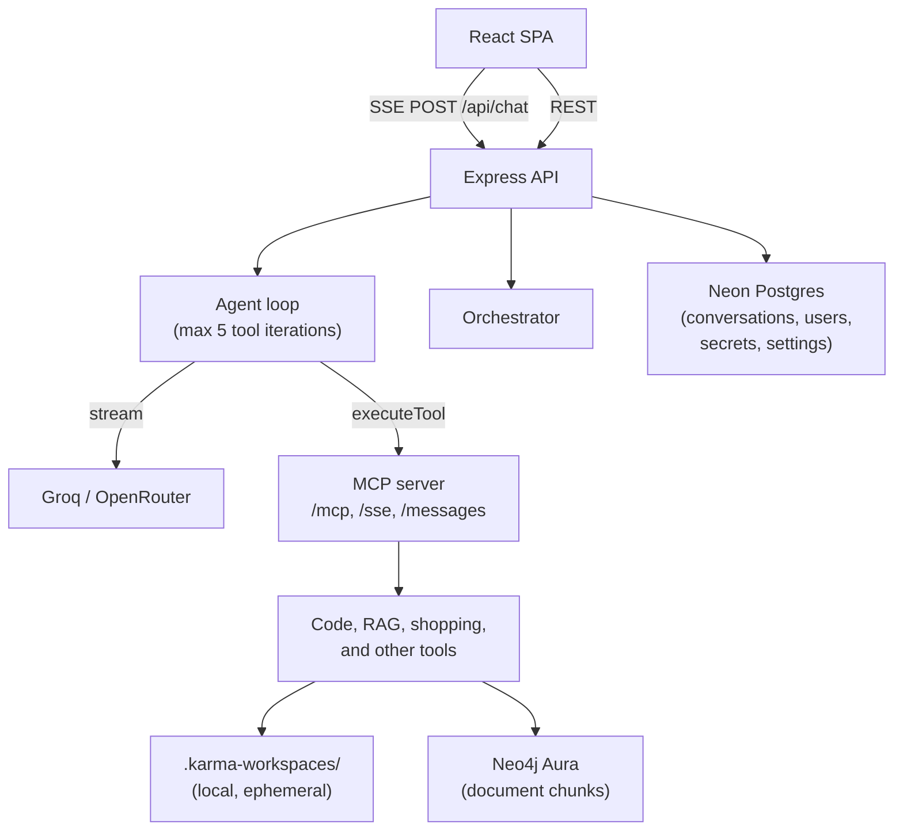
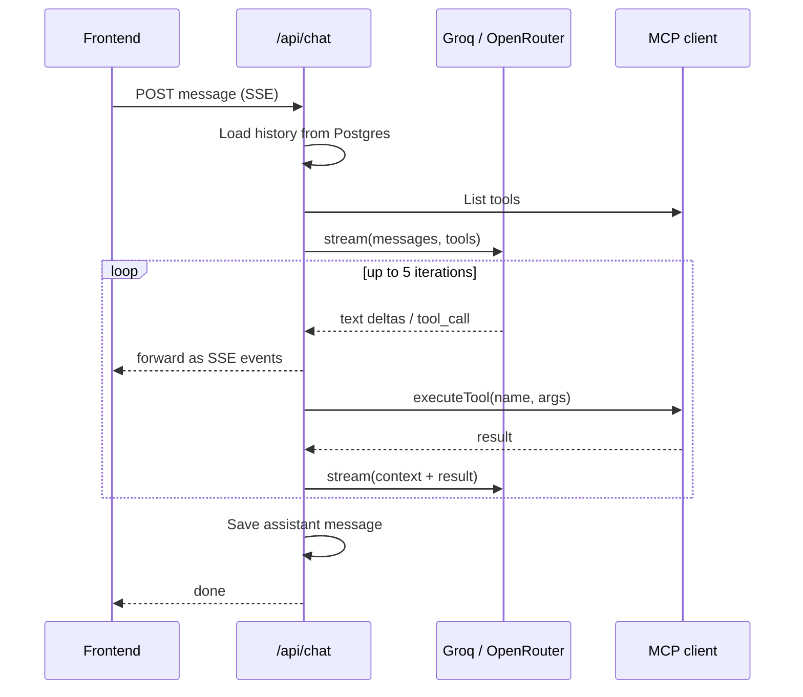

# Karma AI

A full-stack TypeScript chat assistant that streams LLM responses, calls tools through the Model Context Protocol (MCP), answers questions over your documents (RAG), and can inspect public GitHub repositories and propose reviewable edits.

- **Frontend:** React
- **Backend:** Express 5 on Node.js, with the MCP server mounted on the same port
- **LLMs:** Groq (free tier) and OpenRouter (bring your own key)
- **Storage:** Neon Postgres (conversations, users, encrypted keys), Neo4j Aura (optional, RAG vectors)

## What it does

- Streams chat responses over SSE from Groq or OpenRouter.
- Discovers tools at runtime from an MCP server (Streamable HTTP and SSE transports). If the server is unreachable, the client falls back to running the tools in-process.
- Clones a public GitHub repo into a local workspace, lets the model read and search it, and generates diffs for proposed edits. Nothing is written until you approve, and nothing is ever pushed to GitHub.
- Ingests PDF, DOCX, TXT and Markdown files into Neo4j and retrieves relevant chunks with an ensemble retriever. Embeddings (`all-MiniLM-L6-v2`) run locally.
- Splits complex prompts across specialist agents (custom orchestrator plus LangGraph).
- Stores user OpenRouter keys encrypted with AES-256-GCM.
- Supports Google and GitHub OAuth, and voice input via Groq Whisper.

### Status of the rough edges

| Area | State |
|---|---|
| Email/password login | Mock. Accepts any email, no password check. Do not ship it. |
| `manage_lists`, `home_assistant_core` | Mock tools that return canned data. |
| Amazon shopping (`shop_amazon`) | Works, but needs Playwright browsers installed and isn't practical on free hosting. |
| Push edits to GitHub | Not implemented. Edits stay in the local workspace. |
| VSCode extension | Scaffolded only. |
| Multi-agent orchestrator | Works, but task decomposition is uneven across prompt types. |

## Requirements

- Node.js 20 or 22, npm 10+
- Git 2.30+ (used by `code_open_repository`)
- A [Neon](https://neon.tech) Postgres database with `pgvector` (enabled by default on Neon)
- A [Groq](https://console.groq.com) API key
- Optional: a Neo4j Aura instance (RAG), an OpenRouter key, a SerpAPI key

## Quick start

```bash
git clone <your-repo-url>
cd ai_eng

# backend
cd backend
npm install
cp .env.example .env     # fill in DATABASE_URL, DATABASE_URL_UNPOOLED, SECRETS_MASTER_KEY, GROQ_API_KEY
npm run db:migrate
npm run dev              # API + MCP on http://localhost:3001

# frontend (new terminal)
cd frontend/app
npm install
cp .env.example .env     # set VITE_USE_MOCK=false to talk to the real backend
npm run dev              # http://localhost:5173
```

The Vite dev server proxies `/api/*` to `http://localhost:3001`.

Generate a master key with:

```bash
openssl rand -hex 32
```

## Configuration

### Backend (`backend/.env`)

| Variable | Required | Notes |
|---|---|---|
| `DATABASE_URL` | yes | Pooled Neon connection string (host contains `-pooler`). Used by the running app. |
| `DATABASE_URL_UNPOOLED` | for migrations | Direct Neon connection string. Used by drizzle-kit. |
| `SECRETS_MASTER_KEY` | yes | 64-character hex string; encrypts stored API keys. |
| `GROQ_API_KEY` | yes | Starts with `gsk_`. |
| `GROQ_MODEL` | no | `openai/gpt-oss-20b` or `openai/gpt-oss-120b`. |
| `OPENROUTER_FALLBACK_KEY` | no | Server-side fallback when a user hasn't set their own key. |
| `PORT` | no | Defaults to `3001`. |
| `NODE_ENV` | no | `development` or `production`. |
| `FRONTEND_URL` | no | Extra allowed CORS origin. |
| `NEO4J_URI`, `NEO4J_USER`, `NEO4J_PASSWORD` | no | Needed for RAG. On Aura, the user is the instance ID, not `neo4j`. |
| `SERPAPI_KEY` | no | Google Shopping results for `search_products`. |
| `KARMA_CODE_WORKSPACE_ROOT` | no | Where repos are cloned. Defaults to `./.karma-workspaces`. |
| `MCP_PORT` | no | MCP shares the backend port by default. |
| `GOOGLE_CLIENT_ID`, `GOOGLE_CLIENT_SECRET` | no | Google OAuth. |
| `GITHUB_CLIENT_ID`, `GITHUB_CLIENT_SECRET` | no | GitHub OAuth. |
| `MANUS_API_KEY` | no | Used by `build_external_app`. |

### Frontend (`frontend/app/.env`)

| Variable | Notes |
|---|---|
| `VITE_API_ENDPOINT` | Chat endpoint. Defaults to `/api/chat`. |
| `VITE_USE_MOCK` | `true` returns mock responses with no backend. |
| `VITE_GOOGLE_CLIENT_ID` | Google OAuth client ID. |
| `VITE_GITHUB_CLIENT_ID` | GitHub OAuth client ID. |

## LLM providers

**Groq.** Create a key at console.groq.com, set `GROQ_API_KEY`, and pick a `GROQ_MODEL`. The free tier has per-minute token limits, and tool-calling loops burn through them quickly. On a 429, switch to `openai/gpt-oss-120b` (higher limits) or wait a minute.

**OpenRouter.** Create a key at openrouter.ai (starts with `sk-or-v1-`). Either set `OPENROUTER_FALLBACK_KEY` on the server or paste a key into Settings in the app, which stores it encrypted.

## Architecture



### Tool-calling loop



In production the backend also serves the built frontend from `frontend/app/dist`, so everything runs on one port.

## Inspecting a GitHub repo

Example prompts, in order:

```
Open https://github.com/octocat/Hello-World, list its files, and read the README.
```
```
Propose an improved README with a Getting Started section. Show me the diff.
```
```
Looks good, apply it.
```

What happens underneath:

1. `code_open_repository` validates the URL (must be `github.com/<owner>/<repo>`) and runs `git clone --depth=1` into `.karma-workspaces/<uuid>/`.
2. `code_list_files`, `code_read_file`, `code_search`, `code_git_status` and `code_git_diff` inspect the clone. All read-only.
3. `code_propose_edit` builds a unified diff and stores it in memory under a `proposalId`. No file changes.
4. You review the diff in chat.
5. `code_apply_proposal` writes the new content to the workspace copy of the file.

The remote repository is never modified. Workspaces are local and disappear on restart on ephemeral hosts.

## API

Authenticated routes expect `Authorization: Bearer <userId>` or an `x-user-id` header. Outside production, requests without either fall back to a test user.

| Method | Path | Auth | Purpose |
|---|---|---|---|
| GET | `/health` | no | Database health check |
| POST | `/api/chat` | yes | SSE streaming chat |
| GET | `/api/settings` | yes | User settings and key status |
| PATCH | `/api/settings` | yes | Update model or domain preferences |
| PUT | `/api/settings/llm-key` | yes | Save an encrypted OpenRouter key |
| DELETE | `/api/settings/llm-key` | yes | Delete the stored key |
| POST | `/api/settings/llm-key/test` | yes | Test a key before saving |
| GET | `/api/settings/models` | yes | List OpenRouter models |
| GET | `/api/auth/config` | no | OAuth client IDs for the frontend |
| POST | `/api/auth/github` | no | Exchange a GitHub OAuth code |
| POST | `/api/auth/google` | no | Exchange a Google OAuth token |
| POST | `/api/auth/login`, `/api/auth/signup` | no | Mock email/password auth |
| POST | `/mcp` | no | MCP Streamable HTTP |
| GET | `/sse`, POST `/messages` | no | MCP SSE transport |

### `POST /api/chat`

```json
{
  "message": "Open https://github.com/octocat/Hello-World and read the README",
  "conversationId": "optional-uuid",
  "model": "openai/gpt-oss-20b"
}
```

The response is an SSE stream of JSON events:

| `type` | Fields | Meaning |
|---|---|---|
| `delta` | `text`, `seq` | Text chunk |
| `tool_call` | `id`, `name`, `args` | Model invoked a tool |
| `tool_result` | `id`, `name`, `result` | Tool output |
| `lifecycle` | `status` (`thinking`, `executing_tool`, `completed`), `message` | Agent state |
| `done` | `conversationId`, `messageId` | Stream finished |
| `error` | `error` | Something failed |

## MCP tools

| Tool | What it does | Arguments | Side effects |
|---|---|---|---|
| `code_open_repository` | Clone a public GitHub repo | `repositoryUrl` | Creates a workspace directory |
| `code_list_files` | List files | `repoId`, `path?` | None |
| `code_read_file` | Read a file | `repoId`, `filePath` | None |
| `code_search` | Text search | `repoId`, `query`, `maxResults?` | None |
| `code_git_status` | `git status` | `repoId` | None |
| `code_git_diff` | `git diff` | `repoId` | None |
| `code_propose_edit` | Create a diff proposal | `repoId`, `filePath`, `proposedContent` | Stored in memory only |
| `code_apply_proposal` | Apply an approved proposal | `proposalId` | Writes a file in the workspace |
| `knowledge_retrieval` | Query the knowledge base | `subject`, `depth?` | None |
| `list_documents` | List ingested documents | none | None |
| `rag_ingest` | Ingest a document | `file_path` or `content` | Writes to Neo4j |
| `shop_amazon` | Search Amazon.in and add to cart | `query`, `maxPriceINR?` | Playwright browser automation |
| `search_products` | Product search with price filter | `query`, `maxPriceINR?` | SerpAPI request |
| `travel_planner` | Draft an itinerary | `destination_query`, `mode?` | None |
| `manage_lists` | Query personal lists | `action`, `filter?` | None (mock) |
| `home_assistant_core` | Smart-device commands | `query`, `device?`, `state?` | None (mock) |
| `creative_studio` | Creative outlines | `prompt`, `style?` | None |
| `maps_search` | Resolve places and routes | `query`, `location?` | None |
| `build_external_app` | Hand off to Manus/Replit | `prompt`, `provider?` | External API call |

`shop_amazon`, `manage_lists`, `home_assistant_core` and `rag_ingest` require user confirmation before they run.

## Development

```bash
cd backend
npx tsc -p tsconfig.json --noEmit     # type check
npm test                              # all tests (Vitest)
npx vitest run mcp/rag/store.test.ts  # one file

cd ../frontend/app
npx tsc -b                            # frontend type check
```

Migrations live in `backend/src/db/migrations/` and are applied by `npm run db:migrate` using `DATABASE_URL_UNPOOLED`. Always use the direct connection for migrations, not the pooled one.

## Production build

```bash
cd frontend/app && npm run build   # -> frontend/app/dist
cd ../../backend && npm run build  # -> backend/dist
npm start                          # API + static frontend on $PORT (default 3001)
```

## Deploying to Render

`render.yaml` at the repo root defines two services:

| Service | Type | Root | Build | Start |
|---|---|---|---|---|
| `karma-web` | Static site | `frontend/app` | `npm install && npm run build` | n/a |
| `karma-api` | Web service | `backend` | `npm install --include=dev && npm run build` | `npm start` |

1. Push the repo to GitHub.
2. In Render: New, then Blueprint, and select the repo.
3. On `karma-api`, set: `DATABASE_URL`, `DATABASE_URL_UNPOOLED`, `SECRETS_MASTER_KEY`, `GROQ_API_KEY`, `GROQ_MODEL`, `FRONTEND_URL`, `NODE_ENV=production`, `PORT=10000`, and the `NEO4J_*` variables if you use RAG.
4. On `karma-web`, set `VITE_API_ENDPOINT` to `https://<your-api>.onrender.com/api/chat`.
5. Deploy, then check `GET /health` returns `{"status":"ok"}`.

Migrations do **not** run on startup. After the first deploy, run them once from the Render Shell or from your machine:

```bash
DATABASE_URL_UNPOOLED=<direct-url> node -e "import('./dist/db/migrate.js')"
```

The free tier has ephemeral disk, so cloned repos in `.karma-workspaces/` vanish on restart. Use a paid plan with a mounted disk if you need them to persist.

## Security notes

- **API keys at rest:** AES-256-GCM in Postgres; never returned in plaintext.
- **Path traversal:** `safeFilePath()` resolves every path and rejects anything outside the repo root.
- **Repo URLs:** `parseGitHubUrl()` checks scheme, host (`github.com`) and `owner/repo` shape.
- **Cloned code is never executed.**
- **Limits:** 200 KB per file, 3000 files per repo.
- **CORS:** allowlist of localhost, `*.onrender.com`, and `FRONTEND_URL`.
- **Logging:** Pino is configured not to log `DATABASE_URL`, `GROQ_API_KEY` or `SECRETS_MASTER_KEY`.

Things to fix before exposing this to real users:

- The Bearer token is a plain user ID, not a signed session or JWT. Anyone who knows a user ID can act as that user.
- Email/password auth is a mock.
- `/mcp`, `/sse` and `/messages` have no authentication.

## Troubleshooting

**Groq 429.** Set `GROQ_MODEL=openai/gpt-oss-120b` or wait a minute.

**Database won't connect.** `DATABASE_URL` should be the pooled string (`-pooler` in the host) with `sslmode=require`. Check the project isn't suspended in the Neon console.

**Tools not discovered.** The MCP server shares the API port at `/mcp`. If it's down, the client runs tools in-process, so core functionality still works.

**`code_open_repository` fails.** Make sure `git` is on `PATH`, the repo is public, and `KARMA_CODE_WORKSPACE_ROOT` is writable.

**Neo4j connection refused.** Aura's free tier pauses after about three days of inactivity; resume it in the Aura console. Also check that `NEO4J_USER` is the instance ID.

**Frontend can't reach the backend.** In dev, check the proxy target in `frontend/app/vite.config.ts`. In production, check `VITE_API_ENDPOINT`.

## Limitations

- Free Groq models hit rate limits fast during multi-step tool use.
- Workspaces are not persisted across restarts on free hosting.
- Edits can't be pushed to GitHub.
- Amazon automation needs `npx playwright install chromium` and a host that can run a browser.
