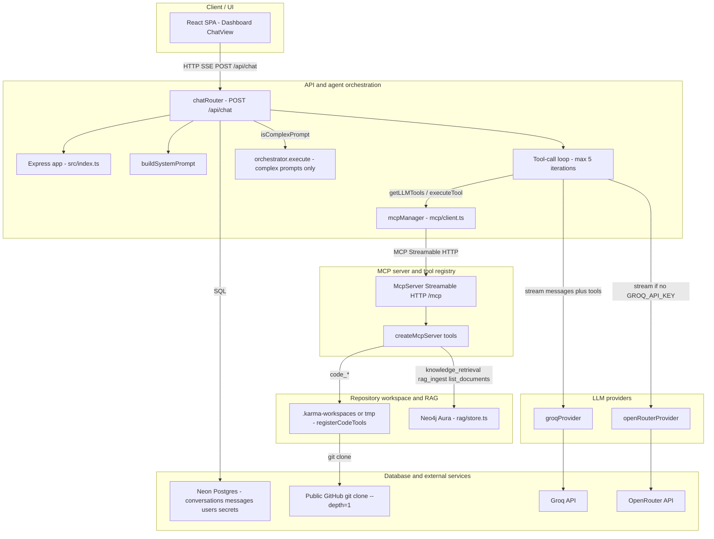
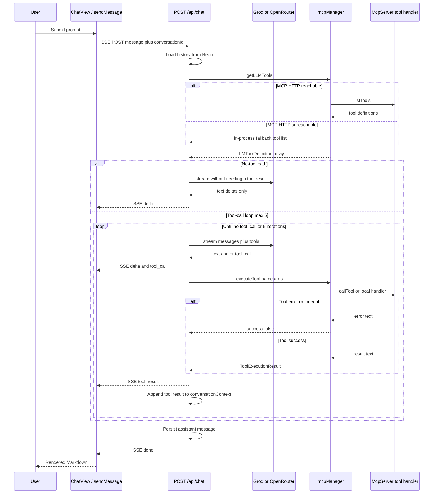
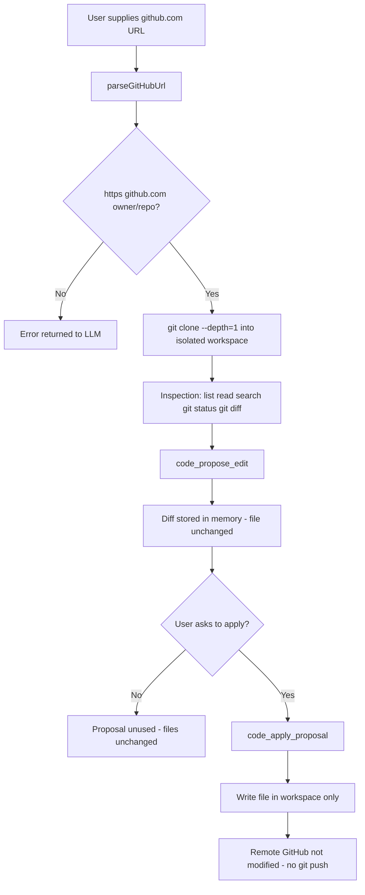

# Karma Architecture

Source-backed diagrams for interviewers. Component names match the code.

## High-level request flow

## LLM-to-MCP tool-calling sequence

Implemented in `backend/src/routes/chat.routes.ts` (`MAX_TOOL_ITERATIONS = 5`).

Direct-intent shortcuts exist before this loop: Amazon (`shop_amazon`) and app-builder (`build_external_app`) can short-circuit without the LLM tool loop.

## GitHub inspection and proposed-edit safety

Implemented in `backend/mcp/tools/code/registerCodeTools.ts`. Approval is conversational: the model is instructed to call `code_apply_proposal` only after the user agrees. There is no separate UI approval gate for code edits. Changes are never pushed to GitHub.

